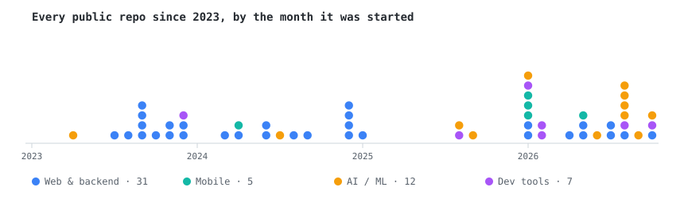

<h1 align="center">Varad Patil</h1>

<p align="center">
  I build across the stack: web apps, mobile apps, backends, dev tools, and the ML behind them.<br/>
  M.Tech @ IIT Kanpur · Computer Engineering grad · 60+ public repos since 2023.
</p>

<p align="center">
  <a href="https://varaddev.vercel.app"></a>
  <a href="https://varadiitk.vercel.app"></a>
  <a href="https://linkedin.com/in/varad-patil-web-dev"></a>
  <a href="mailto:varadapatil123@gmail.com"></a>
</p>

---

<pre>
<b>$ git log --oneline --author="varad"</b>

<a href="https://github.com/DevVaradPatil/Campus-Resolve-App">9a2c68d</a>  feat(web):    CampusResolve — hostel complaint tracker for an IIT Kanpur student pilot
<a href="https://github.com/DevVaradPatil/clawd-companion">f919305</a>  feat(tools):  Clawd Companion — a pixel mascot that acts out what Claude Code is doing
<a href="https://github.com/DevVaradPatil/cleanair-copilot">206d661</a>  feat(ai):     Clean Air Copilot — bilingual RAG + text-to-SQL over Indian air-quality policy
<a href="https://github.com/DevVaradPatil/vayusetu">5d5a79c</a>  feat(ai):     VayuSetu — tells a district officer why the air is bad and who should act
<a href="https://github.com/DevVaradPatil/Pulse---Keep-Alive-Project">ca9eda7</a>  feat(infra):  Pulse — zero-cost uptime monitor on GitHub Actions + Pages
<a href="https://github.com/DevVaradPatil/Krippendorff">1a544e9</a>  feat(ai):     Krippendorff — code-grading agent, measured against its baselines
<a href="https://github.com/DevVaradPatil/Grievance-Whatsapp-Chatbot-System">771cc1f</a>  feat(api):    DJB WhatsApp CRM — grievance backend on the WhatsApp Cloud API
<a href="https://github.com/DevVaradPatil/nutristep">6b41d98</a>  feat(web):    NutriStep — 36 interactive nutrition lessons in English + Hindi
<a href="https://github.com/DevVaradPatil/civicpulse_vibe2ship">c19ad76</a>  feat(web):    CivicPulse — civic-issue platform, top 20 of 15,000+ at Vibe2Ship
<a href="https://github.com/DevVaradPatil/hava">5a5bfa6</a>  feat(mobile): Hava — health + AQI companion app in Flutter
<a href="https://github.com/DevVaradPatil/SafePrompt">3bed023</a>  feat(tools):  SafePrompt — Chrome extension that masks PII before it reaches ChatGPT
<a href="https://github.com/DevVaradPatil/ChatDex">a5bf8c3</a>  feat(tools):  ChatDex — table-of-contents sidebar for long ChatGPT chats
<a href="https://github.com/DevVaradPatil/messGo">d95a1d8</a>  feat(mobile): messGo — hostel mess management app in Flutter
<a href="https://github.com/DevVaradPatil/AI-Form-Builder">b5215b7</a>  feat(web):    AI Form Builder — Next.js 15 + Supabase, forms generated from a prompt
<a href="https://github.com/DevVaradPatil/wordigo_privacy_policy">054de89</a>  release:      Wordigo — daily word puzzle on the Play Store, 100+ levels
<a href="https://github.com/DevVaradPatil/frontend-toolbox">eba5a16</a>  feat(tools):  Frontend Toolbox — CSS generators and layout playgrounds
<a href="https://github.com/DevVaradPatil/resume-analyzer">3a0a741</a>  feat(web):    Resume Analyzer — Next.js + Gemini resume feedback
<a href="https://github.com/DevVaradPatil/spotify-2.O">26927fc</a>  feat(web):    Spotify 2.0 — Next.js + Supabase + Stripe subscriptions
<a href="https://github.com/DevVaradPatil/snikrz">8525f9d</a>  feat(web):    Snikrz — MERN e-commerce with Stripe checkout
<a href="https://github.com/DevVaradPatil/threads-app">60fb4a7</a>  init:         first full-stack clone, and it never stopped

<b>$ git log --grep="milestone"</b>

  B.Tech Computer Engineering, RIT — Gold Medal, Rank 1
  First-author Springer paper, RAG legal chatbot (ICTCS 2024)
  Intern @ Altair Engineering · Community Lead, GDG on Campus RIT (45+ students)
  M.Tech AI for Sustainability, IIT Kanpur · Reliance Foundation PG Scholar · TA
</pre>

---

### 🗺️ Shipping map

<p align="center">
  
</p>

---

### 📌 Start here

| | |
|---|---|
| **[NutriStep](https://nutristep.vercel.app/en)** · *web*<br/>Typed lesson content means a missing Hindi translation fails the build instead of shipping a blank card. Progress is local-first; sign-in is optional. | **[Pulse](https://github.com/DevVaradPatil/Pulse---Keep-Alive-Project)** · *infra*<br/>Keeps free-tier projects awake and monitors uptime using only GitHub Actions and Pages, for about 34 of 2,000 free minutes a month. |
| **[Clawd Companion](https://github.com/DevVaradPatil/clawd-companion)** · *dev tool*<br/>A status bar for Claude Code: context, usage limits and turn time, plus a mascot that reacts to what the agent is doing. | **[CampusResolve](https://campusresolve-bay.vercel.app)** · *web*<br/>Built for a real hostel pilot. Firebase emulators, security-rules tests and an admin flow from day one. |
| **[Krippendorff](https://github.com/DevVaradPatil/Krippendorff)** · *AI*<br/>Same model, better pipeline: misconception F1 goes from 0.46 to 0.93, and prompt-injection success drops from 19% to 1%. | **[VayuSetu](https://vayusetu-999960875509.asia-south1.run.app)** · *AI + web*<br/>Checks whether each monitor can be trusted, finds hotspots the city average hides, and explains them in ten Indian languages. |

---

### 🧰 Toolbox

```
frontend   TypeScript · React · Next.js · Tailwind · Three.js · Framer Motion
backend    Node · Express · FastAPI · Flask · MongoDB · Supabase · Firebase · DuckDB
mobile     Flutter · Dart
infra      Docker · Vercel · GCP Cloud Run · GitHub Actions · Stripe · Razorpay
ml         PyTorch · transformers · LangChain · Qdrant · FAISS · YOLO · XGBoost
```

---

<pre>
<b>$ git status</b>
On branch main
Your branch is ahead of 'origin/main' by a few side projects.
</pre>
